

# AKIRAMAEDA
### CLASS · Agent Designer / Education Engineer

`Agent Design` · `Education` · `Engineering` · `UX` · `LLM Agents` · `AI Literacy`

  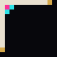
  &nbsp;
  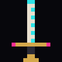
  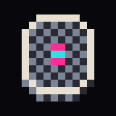
  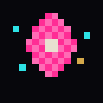
  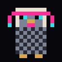
  &nbsp;
  

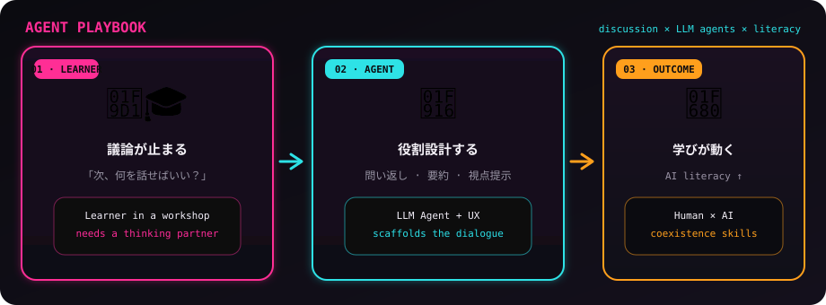

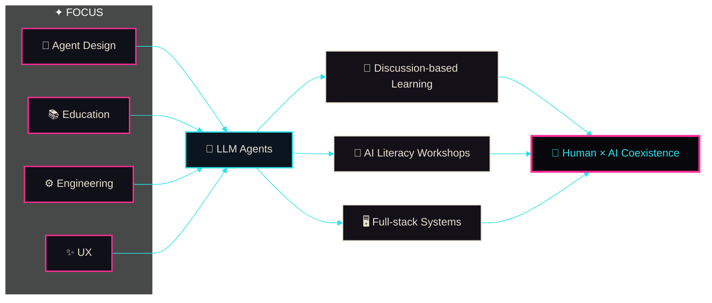

  
  
  

---

## 🪟 ステータス

<table>
  <tr>
    <td width="42%" align="center" valign="top">
      
    </td>
    <td width="58%" align="left" valign="top">
      <pre>
akira@gal:~$ whoami
Akira Maeda - Full Stack Developer 💖

akira@gal:~$ cat about.txt
✨ Passionate about creating amazing web experiences
🚀 Always learning new technologies and frameworks
💕 Love working with React, Node.js, and Python
🎨 Enjoy both frontend and backend development
🌟 Committed to writing clean, maintainable code

akira@gal:~$ ls skills/
Frontend: React, Vue.js, TypeScript, HTML5, CSS3
Backend:  Node.js, Express, FastAPI, Python, Java
Tools:     Git, Docker, Linux, MySQL, MongoDB
Design:    Figma, UI/UX, Responsive Design

akira@gal:~$ ./connect.sh
Let's build something amazing together! 💖

akira@gal:~$ █
      </pre>
    </td>
  </tr>
</table>

---

## 🗺️ フィールド · CONTRIBUTIONS

  

<table>
  <tr>
    <td width="50%" align="center" valign="top">
      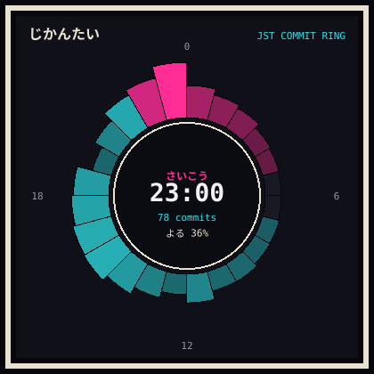
       
      
       よふかし クラス
    </td>
    <td width="50%" align="center" valign="top">
      
       
      
    </td>
  </tr>
</table>

  <picture>
    <source media="(prefers-color-scheme: dark)" srcset="./output/github-snake-dark.svg" />
    <source media="(prefers-color-scheme: light)" srcset="./output/github-snake.svg" />
    
  </picture>

---

## 🎒 どうぐ · AI EQUIPMENT

<pre>
akira@gal:~$ equip --scan gemini openai langchain
</pre>

  
  
  

  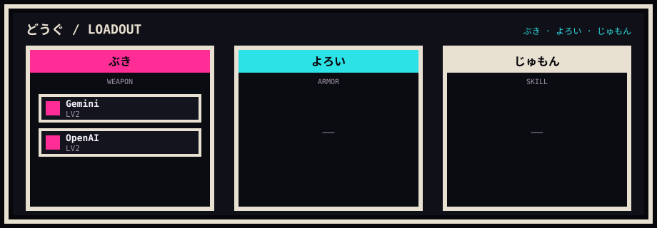

---

## 🧬 じゅもんツリー · LANGUAGES

<pre>
akira@gal:~$ ./skilltree.sh --all --private --org
</pre>

<!-- SKILLICONS:START -->

  

<!-- SKILLICONS:END -->

  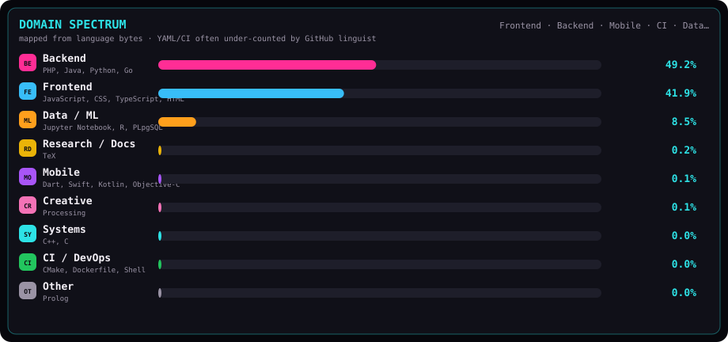
   
  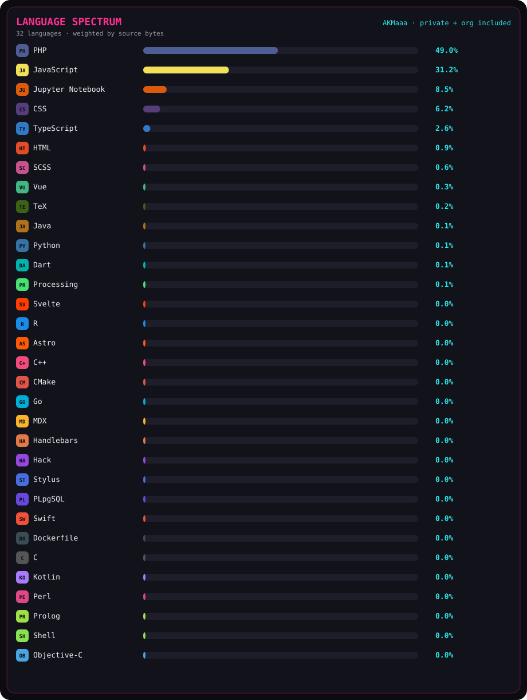

---

## 💎 アイテム · TECH

<pre>
akira@gal:~$ ls tech-stack/
💻 Languages: JavaScript, TypeScript, Python, Java, Go
🎨 Frontend: React, Vue.js, HTML5, CSS3
🔥 Backend: Node.js, Express, FastAPI
🛠️ Others: Git, Docker, Linux, MySQL, MongoDB
🔧 Tools: VSCode, Figma, Slack, Trello, Notion
</pre>

---

## 📜 ぼうけんのしょ · EXPERIENCE

<pre>
akira@gal:~$ cat experience.txt
📊 Professional Experience & Education:
</pre>

### 🏰 いまのクエスト · Current Positions

| Role | Guild | Period | Notes |
|------|-------|--------|-------|
| **研究員** |  [NPO法人学び足しデザイン工房](https://upskillingjp.org/) | 2026.3 - Present | R&D・システム開発部 |
| **エンジニア（正社員）** |  [シンプレクス・ホールディングス株式会社](https://www.simplex.holdings/) | 2026.04 - Present | Financial Technology / Enterprise DX |

### 🗡️ クリア済み · アルバイト・インターン

| Role | Guild | Period | Notes |
|------|-------|--------|-------|
| **エンジニア** |  [ハコレコドットコム株式会社](https://www.hakoreco.com/) | 2021.9 - 2026.3 | アルバイト |
| **エンジニア** |  [株式会社オープンハート](https://openheart.co.jp/) | 2025.5 - 2026.3 | アルバイト |
| **デザイナー** |  [株式会社サイバーエージェント](https://www.cyberagent.co.jp/) | 2023.3 | インターン |
| **エンジニア** |  [ソニーセミコンダクタソリューションズ株式会社](https://www.sony-semiconductor.co.jp/) | 2023.2 | インターン |
| **Campus Leader** |  [Notion Labs, Inc.](https://www.notion.so/) | 2024.8 - 2025.7 | インターン |
| **エンジニア** |  [シンプレクス・ホールディングス株式会社](https://www.simplex.holdings/) | 2024.9 | インターン |
| **エンジニア** |  [株式会社ナビタイムジャパン](https://www.navitime.co.jp/) | 2022.9 | インターン |
| **デザイナー** |  [日本アイ・ビー・エム株式会社](https://www.ibm.com/jp-ja) | 2022.9 | インターン |
| **ビジネスコンサルタント** |  [株式会社船井総合研究所](https://www.funaisoken.co.jp/) | 2022.8 | インターン |

<table>
  <tr>
    <td width="55%" valign="top">

### 🎓 Origin · Education

| Degree | Institution | Period | Field |
|--------|-------------|--------|-------|
| **修士** | 公立はこだて未来大学大学院 | 2024.4 - 2026.3 | システム情報科学・メディアデザイン |

### 🔬 Research Codex

<pre>
akira@gal:~$ cat research.txt
📚 議論を基盤とした学習 × LLMエージェント / AIリテラシー教育
🔗 researchmap: <a href="https://researchmap.jp/akira-maeda">researchmap.jp/akira-maeda</a>
</pre>

- **LLMエージェント** の役割設計・UI/UX
- ワークショップ・科学コミュニケーションを通じた **AIリテラシー教育** の開発と実践
- 生成AIの授業利用・キャリア教育など、**教育工学 / ヒューマンインタラクション** の応用

| Year | Venue | Paper |
|------|-------|-------|
| 2026 | AIED 2026 (Springer) | [Effects of Job Task Focused Career Education for Human–AI Coexistence on Students’ AI Career Interest and Career Adaptability](https://link.springer.com/content/pdf/10.1007/978-3-032-29770-9_34) |
| 2025 | ICLEA 2025 | [Effectiveness of Instruction on the Utilization of Generative AI in Problem Solving: A Case Study of Japanese Junior High School](https://library.apsce.net/index.php/ICLEA/article/view/5485) |

    </td>
    <td width="45%" valign="top">

### 🏆 Titles · Awards & Honors

| Date | Award | Organization |
|------|-------|--------------|
| 2026.7 | **第一種奨学金 特に優れた業績による返還免除（全額）** · 修士 | 独立行政法人日本学生支援機構 |
| 2026.3 | **学生セッション優秀発表賞** · 2026年春季全国大会（第48回大会） | 日本教育工学会 |
| 2025.3 | **学生セッション優秀発表賞** · 2025年春季全国大会（第46回大会） | 日本教育工学会 |
| 2022.12 | **最優秀賞** | P2HACKS 2022 |

    </td>
  </tr>
</table>

---

## 🎧 サウンドトラック

<pre>
akira@gal:~$ ./jukebox.sh --litty --badhop --999dobby
</pre>

  <table>
    <tr>
      <td align="center" valign="top" width="33%">
        
         <strong>♪ litty</strong>
      </td>
      <td align="center" valign="top" width="33%">
        <a href="https://youtu.be/ED-kdgPsnPI">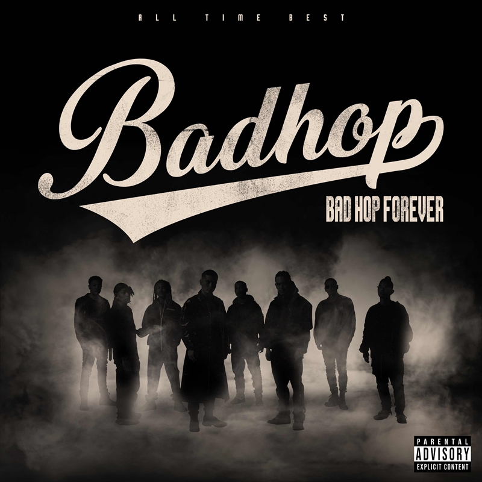</a>
         <strong>♪ badhop</strong>
      </td>
      <td align="center" valign="top" width="33%">
        
         <strong>♪ 999dobby</strong>
      </td>
    </tr>
  </table>

---

## 📡 なかま募集 · CONTACT

<pre>
akira@gal:~$ ./contact.sh
💖 GitHub: <a href="https://github.com/AKMaaa">@AKMaaa</a>
🔬 researchmap: <a href="https://researchmap.jp/akira-maeda">researchmap.jp/akira-maeda</a>
💼 LinkedIn: <a href="https://www.linkedin.com/in/akitch-maeda-akira/">akitch-maeda-akira</a>
🎯 Wantedly: <a href="https://www.wantedly.com/id/akira_maeda_q">akira_maeda_q</a>
📧 Email: <a href="mailto:akira@aiedu.jp">akira@aiedu.jp</a>
</pre>

